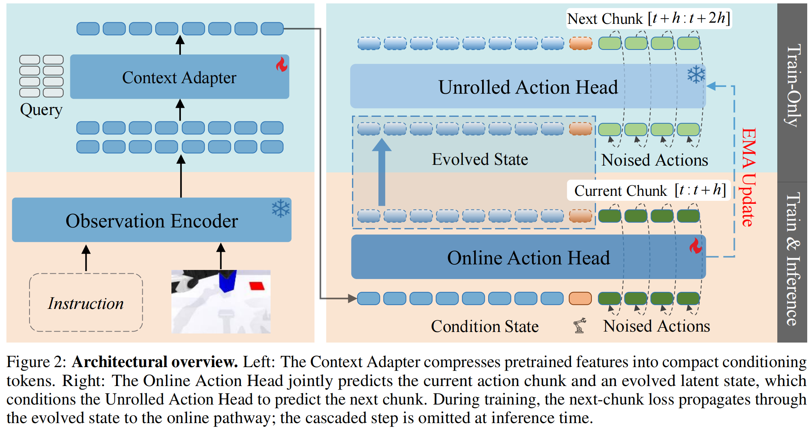

# AdaPolicy: Action-Driven Anticipatory Robot Policies via Next-Chunk Prediction

[arXiv](https://arxiv.org/abs/2610.34280) | [Project Page](https://teee111.github.io/AdaPolicy/)

AdaPolicy is an action-driven anticipatory policy framework that requires no explicit supervision from future observations in pixel or latent space. By backpropagating future action prediction errors through a cascaded unroll, it shapes a compact and control-aligned future-aware state for the online policy. The framework remains lightweight to train and adds zero inference-time overhead.

The `metaworld/` directory contains the MetaWorld imitation-learning release: joint
imitation learning on 50 MetaWorld tasks.

The `robotwin/` directory contains training code for 50 tasks in the RoboTwin 2.0 environment.



## Videos

- [Earphone](assets/videos/AdaPolicy_earphone.mp4)
- [Shoelacing](assets/videos/AdaPolicy_shoelacing.mp4)


### Installation

```bash
conda create -n adapolicy python=3.10 -y
conda activate adapolicy

pip install torch==2.7.1 torchvision==0.22.1 --index-url https://download.pytorch.org/whl/cu128

pip install transformers==5.0.0rc0 omegaconf accelerate h5py opencv-python

# MetaWorld / MuJoCo
pip install metaworld==3.1.1 mujoco gymnasium

pip install scipy matplotlib openpyxl imageio tqdm
```

Run the remaining MetaWorld commands from the `metaworld/` directory:


## Dataset

The training data (HDF5) is hosted on [ModelScope](https://modelscope.cn/datasets/yangfan97/CNCPolicy-Metaworld-Data-hdf5).

```bash
pip install modelscope

# (optional) move the cache to a data disk
export MODELSCOPE_CACHE=/root/autodl-tmp/modelscope_cache

# parallel download
modelscope download --dataset yangfan97/CNCPolicy-Metaworld-Data-hdf5 --max-workers 10

# unzip all archives into the current directory
cd $MODELSCOPE_CACHE/datasets/yangfan97/CNCPolicy-Metaworld-Data-hdf5
for f in *.zip; do unzip -q -o "$f"; done
```

Then set `dataset.dataset_dir` in `configs/metaworld.yaml` to the path of your
unpacked dataset root. To collect your own demonstrations instead, run
`python scripts/gen_data_hdf5.py`.

## Preparation

1. **DINOv3 weights**: download `dinov3-vitb16-pretrain-lvd1689m` into
   `./dinov3_pretrain/` (`model.vision_encoder.checkpoint_path` in the config
   points to it). 
2. **Demonstration data**: see the **Dataset** section above; make sure
   `dataset.dataset_dir` in `configs/metaworld.yaml` points to your dataset root
3. **Normalization stats**: `python utils/compute_norm_stats_metaworld.py`
   (`utils/stat-metaworld.json` is included and can be reused directly if the
   data matches)

## Training

```bash
./run_train_ema.sh all 40       # early stop after epoch 40
./run_train_ema.sh resume <ckpt>  # resume training 
```

Checkpoints are saved to `checkpoints_vla/ema_ig_all_<timestamp>/` and contain
`model_state_dict` and `ema_state_dict`; saved every 5 epochs, with the training
`config.yaml` stored alongside.

Key config of (`configs/metaworld.yaml` → `training`):
`use_next_chunk_pred: true` (next-chunk prediction), `lambda_next_chunk: 0.8`,
`use_ema: true`, `ema_decay: 0.99`, `batch_size: 128`,
`common.action_chunk_size: 8` (first 8 steps executed at inference).

## Evaluation

```bash
./run_train_ema.sh eval checkpoints_vla/<run>/checkpoint_epoch_40.pt all 50
# or:
python scripts/eval_metaworld_parallel.py \
    --config <ckpt_dir>/config.yaml --checkpoint <ckpt.pt> \
    --task all --num-episodes 50 --num-envs 50
```

## RoboTwin 2.0

For data download and preprocessing in the RoboTwin 2.0 environment, refer to [LiLa-WAM](https://github.com/teee000/LiLa-WAM).
